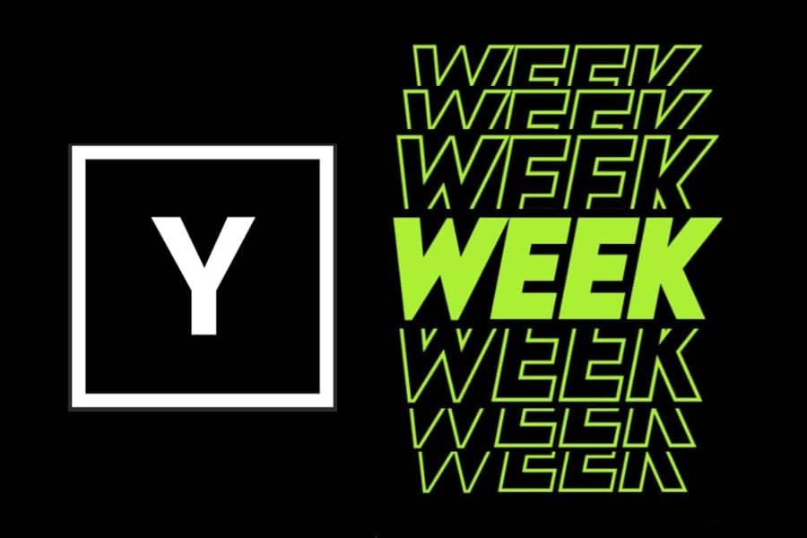

_⚠️ **THIS POST IS GENERATED WITH LLMs**: This post is newly generated a few times a week based on trending articles from hacker news. It takes the tone of my writing style, takes the topic from Hacker News - throws in some LLM magic and generates this post. Please be aware I don't read what gets generated here - it means I may agree, I may not - its a crap shoot - its not meant to be an opinion piece but merely [an experiment](https://github.com/clintjb/Weekly-Post) with the services from [OpenRouter](https://openrouter.ai) - last updated Tuesday 10 November 2026_

Well, here we are again. The pace of this space never really takes a proper pause, does it? I was sitting down with my morning coffee this week, watching the latest wave of model updates roll out, and I couldn’t help but smile. There’s something genuinely satisfying about watching a tool you’ve grown to respect just… level up in a way that actually makes the day-to-day work smoother.

Anthropic just dropped Fable 5.2 and Mythos 5.2, and honestly? The engineering team has quietly done something remarkable. I’ve been running some of the heavier workflows we’ve been pushing lately, and the shift in clarity and speed is genuinely noticeable. They’re talking about 30% faster generation, lower token costs, and this optional fast mode that feels like turning a dial on precision. But what really caught my attention wasn’t just the benchmark numbers—it was the way the model actually *thinks* through ambiguous requests. It doesn’t just parrot back what you ask; it tries to understand the intent behind it.

You know how I always say it’s not about throwing more compute at a problem, it’s about closing the gap between high-level vision and operational reality? This feels like a step in that direction. At medium effort, Fable 5.2 is handling complex agentic coding and hardware design workflows with fewer tokens than previous iterations. That’s not just a line on a chart—that’s less waste, tighter feedback loops, and more room for the human in the loop to actually steer the ship. When you strip away the noise, you’re left with something that just works.

I have to mention the prototype operating system experiment, though. It’s the kind of thing that sounds like science fiction until you actually watch it boot up on a laptop. Coordinated over a thousand subagents across eight days, wrote its own drivers, file system, even a login screen and installer. It’s wild to watch a model go from an empty folder to a functional OS without hand-holding. It’s not about replacing engineers—it’s about showing what happens when you give a capable system enough room to try, fail, and iterate. The engineering judgment on display is what really stands out.

Of course, with that kind of capability comes the responsibility of actually keeping it grounded. The team has leaned hard into safety testing, sandbox escape evaluations, and tighter protections against distillation attacks. It’s reassuring to see a group that isn’t just racing toward raw capability but actually pausing to stress-test the edges. High-stakes risks might still feel abstract to most, but anyone who’s shipped production code knows that alignment isn’t a feature—it’s infrastructure. You build it in, or you pay for it later.

I’ve been thinking a lot about how this fits into the actual rhythm of development. For most of us, you still start with the daily driver models and only scale up when the problem genuinely demands it. But when you’re migrating legacy services, untangling multi-step research threads, or designing circuit boards, having a model that exercises real judgment changes everything. Less back-and-forth. Less “no, I meant…”. Just steady, reliable output that respects the context. It’s the kind of shift that lets teams focus on the work that actually matters instead of constantly context-switching to fix misaligned outputs.

We’re not at the finish line, obviously. None of us are. But watching these models iterate, refine, and actually close the gap between what we ask for and what gets built? It’s a good feeling. I’ll be leaning into the newer versions for the heavier lifts this quarter, mostly just to see where the effort-to-cost curve flattens out next. And if you’ve been testing them yourself—drop a line. I’d love to hear what’s working, what’s still stubborn, and what you’re building with it.

Anyway, I’m off to wrestle with a stubborn Python script and probably overcomplicate my weekend batch of ribs. Talk soon. 🌮

